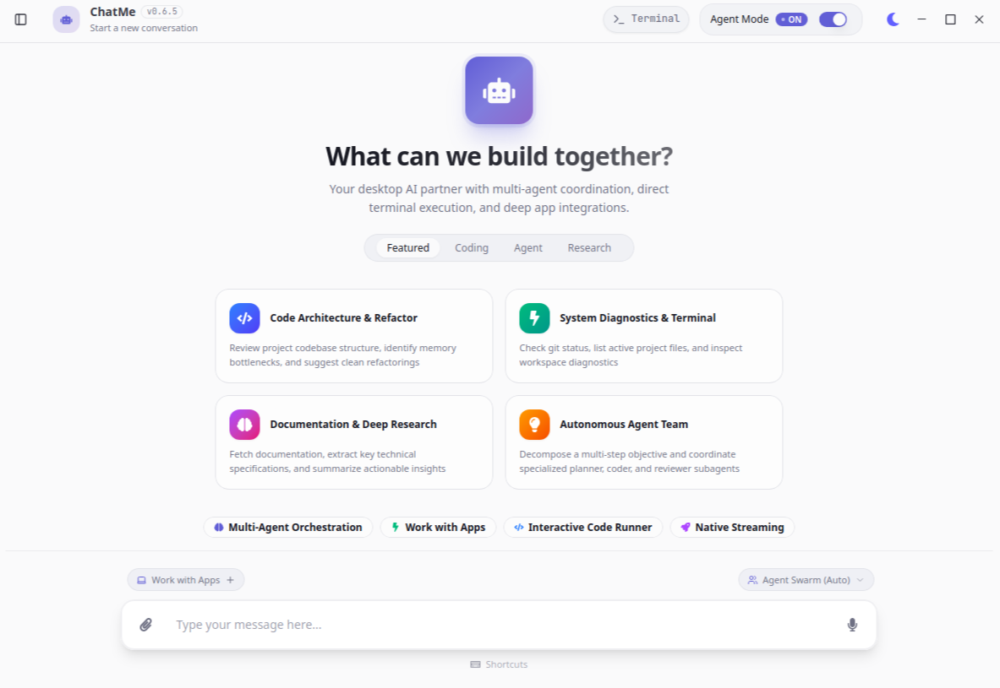
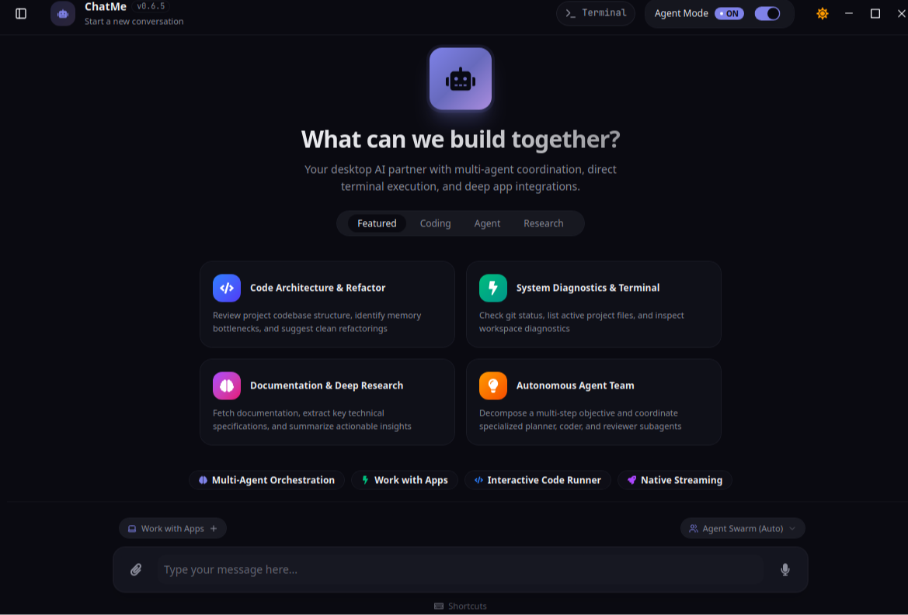
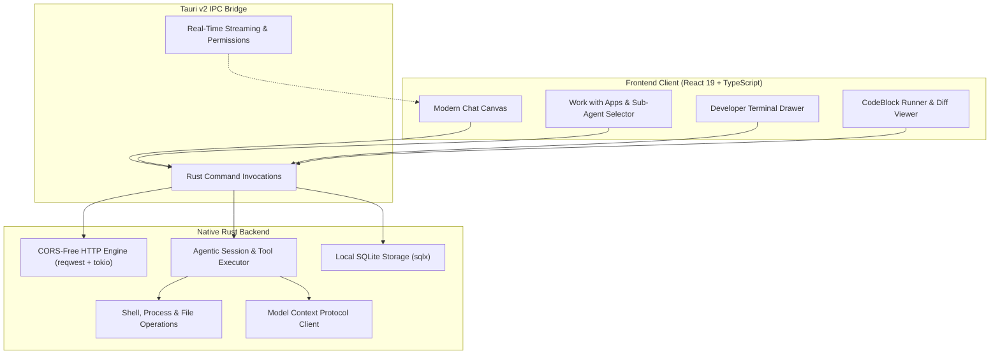

<div align="center">

# ChatMe 🤖
### The Open-Source, Multi-Agent Desktop AI with System Access & App Integrations

[](https://github.com/Amanbig/ChatMe/releases)
[](LICENSE)
[](https://v2.tauri.app/)
[](https://react.dev/)
[](https://www.rust-lang.org/)
[](CONTRIBUTING.md)

<p align="center">
  <b>ChatMe</b> is a fast, privacy-first desktop application that combines <b>multi-agent autonomous workflows</b>, <b>ChatGPT Desktop-style app connections</b>, <b>direct code execution</b>, and <b>voice interaction</b> powered by 13+ cloud and local AI providers.
</p>

[Download Latest Release](https://github.com/Amanbig/ChatMe/releases) • [Features](#-core-features) • [Architecture](#-architecture) • [Getting Started](#-getting-started) • [Contributing](CONTRIBUTING.md)

<br/>

<table align="center">
  <tr>
    <td align="center">
      
      <br/><sub><b>Light Mode</b></sub>
    </td>
    <td align="center">
      
      <br/><sub><b>Dark Mode</b></sub>
    </td>
  </tr>
</table>

</div>

---

## ⚡ What Sets ChatMe Apart?

| Feature | ChatMe (Open Source) | ChatGPT Desktop | Claude Desktop |
| :--- | :---: | :---: | :---: |
| **Local Offline Models (Ollama, LMStudio)** | ✅ Native | ❌ Cloud only | ❌ Cloud only |
| **Multi-Provider Ecosystem (13+ APIs)** | ✅ Universal | ❌ OpenAI only | ❌ Anthropic only |
| **"Work with Apps" Context Attachment** | ✅ VS Code, Terminal, Browser | ✅ Limited apps | ❌ None |
| **Autonomous Multi-Agent Swarm** | ✅ Planner, Coder, Reviewer, etc. | ❌ Single agent | ❌ Single agent |
| **Interactive In-Chat Code Runner** | ✅ Direct Run (Bash, Python, Node) | ❌ Read-only | ❌ Read-only |
| **Integrated Developer Terminal Drawer** | ✅ Instant (`Ctrl + \``) | ❌ None | ❌ None |
| **Model Context Protocol (MCP)** | ✅ First-class client | ❌ None | ✅ Supported |
| **Full Data Ownership (Local SQLite)** | ✅ 100% On-Device | ❌ Cloud hosted | ❌ Cloud hosted |

---

## 🌟 Core Features

### 🖥️ 1. "Work with Apps" (ChatGPT Desktop Style)
- Connect ChatMe with running applications on your computer:
  - **VS Code & Cursor**: Injects active workspace directory, file hierarchy, and editing context.
  - **Developer Terminal**: Grants shell authorization and directory awareness.
  - **Web Browsers**: Reads external URLs, parses web documentation, and inspects APIs.
  - **File Explorer**: Analyzes directory trees and project assets.
- Live background app detection with visual connection pills in the input toolbar.

### 🤖 2. Multi-Agent Autonomous Swarm
- Direct queries to specialized sub-agents or let the **Autonomous Swarm** self-coordinate:
  - 🧠 **Architecture & Planning Agent**: Breaks complex goals into milestone roadmaps.
  - 💻 **Full-Stack Engineering Agent**: Writes code, modifies files, and creates diffs.
  - 🔍 **Research & Web Intelligence Agent**: Scrapes web docs and inspects codebase patterns.
  - 🛡️ **Security & Quality Reviewer**: Audits proposed changes for safety and edge cases.
  - ⚡ **DevOps & System Operator**: Executes shell commands and monitors diagnostics.
- Interactive **Agent Orchestrator Cards** display real-time sub-task progression.

### ⚡ 3. Interactive CodeBlock Runner & Diff Viewer
- Direct **"Run"** action on code blocks (`bash`, `sh`, `zsh`, `python`, `node`) with inline execution drawers displaying exit codes, stdout, stderr, and run duration.
- Automatic line-by-line colored **Diff Viewer** for `diff` and `patch` blocks.

### 💻 4. Slide-Up Developer Terminal Drawer
- Press **`Ctrl + \``** (or **`Cmd + \``**) or click **Terminal** in the top navigation bar to toggle the integrated terminal.
- Run shell commands, inspect build logs, and navigate command history with Up/Down arrow keys.

### 🌐 5. 13+ Cloud & Local AI Providers
- **Cloud Providers**: OpenAI (GPT-4o), Anthropic Claude (3.5 Sonnet), Google Gemini (1.5 Pro), DeepSeek, Groq, Mistral AI, OpenRouter, Together AI, Kimi, Perplexity.
- **Local & Offline**: Ollama, LMStudio, and custom OpenAI-compatible endpoints.
- **Native Streaming**: Rust backend delivers ultra-low latency chunked streaming without CORS limitations.

### 🎤 6. Real-time Speech Interaction
- **Speech-to-Text (STT)**: High-accuracy voice dictation directly into the prompt.
- **Text-to-Speech (TTS)**: Natural voice playback with adjustable pitch, speed, and volume.

### 📤 7. One-Click Chat Exporter
- Export conversations to clean **Markdown (`.md`)** or structured **JSON (`.json`)** with one click directly from the chat header.

---

## 🏛️ Architecture

ChatMe pairs a high-performance **Rust backend** (using Tauri v2) with a **React 19 + Tailwind v4** client:



---

## 🚀 Getting Started

### Prerequisites
- [Node.js](https://nodejs.org/) (v18 or higher)
- [npm](https://www.npmjs.com/)
- [Rust & Cargo](https://rustup.rs/) (stable toolchain)
- Platform-specific Tauri prerequisites (see [Tauri Prerequisites](https://v2.tauri.app/start/prerequisites/))

### Installation & Development

1. **Clone the repository:**
   ```bash
   git clone https://github.com/Amanbig/ChatMe.git
   cd ChatMe
   ```

2. **Install dependencies:**
   ```bash
   npm install
   ```

3. **Start in Web Development mode:**
   ```bash
   npm run dev
   ```

4. **Run as Desktop App (Tauri):**
   ```bash
   npm run tauri:dev
   ```

### Building Release Binaries

To compile native release binaries for your operating system:
```bash
npm run tauri:build
```
Artifacts will be output to `src-tauri/target/release/bundle/`.

---

## 🤝 Contributing

We welcome contributions from developers worldwide! Whether fixing bugs, adding new sub-agent personas, or improving UI responsiveness:

1. Check out our [Contributing Guidelines](CONTRIBUTING.md).
2. Adhere to the [Code of Conduct](CODE_OF_CONDUCT.md).
3. Report bugs or suggest features using our [Issue Templates](.github/ISSUE_TEMPLATE/).
4. Open a Pull Request following our [PR Template](.github/pull_request_template.md).

---

## 🛡️ Security

ChatMe takes user privacy and local machine execution seriously. For vulnerability reporting, please review our [Security Policy](SECURITY.md).

---

## 📄 License

This project is open-source under the [MIT License](LICENSE).
